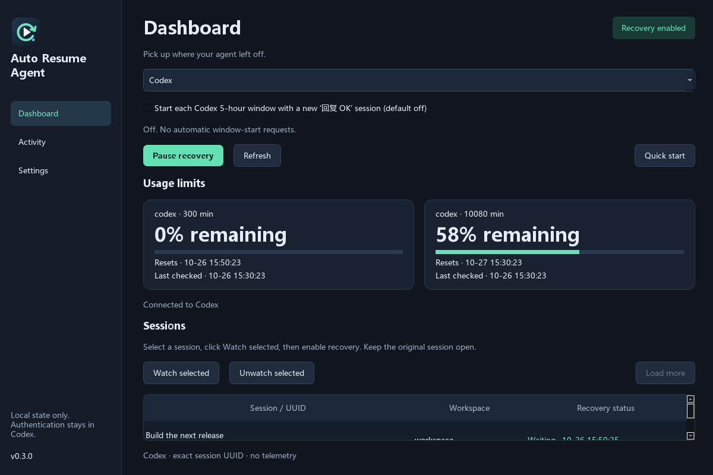

<p align="center"></p>

# Auto Resume Agent

Monitor your AI agent's usage limits and continue the exact interrupted session when capacity returns.

[简体中文](README.zh-CN.md) · [Downloads](https://github.com/yuan-xin-9997/auto-resume-agent/releases) · [Testing & compatibility](docs/TESTING.md)

**Windows, Ubuntu and macOS · native GUI + CLI · five interface languages · local state · no telemetry**

Your agent hits a limit halfway through a task. Auto Resume Agent observes the failed turn, checks the usage windows reported by Codex, and submits a continuation to that session's exact UUID when quota becomes available. It never uses `--last` or types into an agent window.

Supports **Codex CLI/local desktop sessions and OpenCode HTTP server sessions**. Choose the agent in the dashboard or pass `--agent opencode` in the CLI. Claude Code, Gemini CLI and cloud-only Codex sessions are not implemented.



*Illustrative session names and quotas; no personal conversation data.*

| Feature | Behavior |
| --- | --- |
| Usage | Live primary/secondary windows, remaining percentage, local reset times, last check |
| Recovery | Known quota limits, rate limits, temporary connection/stream/server failures |
| Timing | Session checks every 5 seconds; quota every 30 seconds and at due deadlines |
| Sleep/wake | Wall-clock deadlines are re-evaluated on the next scheduled check after wake |
| Identity | Explicitly watched UUIDs only; no automatic recovery of every historical failure |
| Delivery | Durable claim before submission; a timeout/crash never triggers blind resending |
| Safety | Latest-turn check, user cancellation excluded, unknown errors excluded, hourly budget |
| Languages | English · 简体中文 · 繁體中文 · 日本語 · 한국어 |

**Important:** `Queued` means the Codex CLI accepted the continuation. It does **not** prove the original conversation resumed. Keep the original session open in Codex. A closed/unloaded session may remain queued until you open it. `Session progressed` means a newer turn exists; it does not attribute that turn to this tool. The app does not launch an unrestricted replacement agent in the background.

## Install

Download the archive matching your OS and processor from [Releases](https://github.com/yuan-xin-9997/auto-resume-agent/releases). Python is included in native bundles; **The agent you use must be installed separately and logged in** (Codex or an OpenCode server). OpenCode integration baseline: **1.19.3**. The tested integration is Codex CLI **0.163.0**. Run `doctor` to check other versions; the app-server interface is experimental and older versions may lack the required methods.

| Platform | Archive | Open |
| --- | --- | --- |
| Windows 10 1809+ / 11, x64 | `*-windows-x64.zip` | Extract the whole archive, run `Launch.cmd` or `gui/AutoResumeAgent.exe` |
| Ubuntu 24.04 / 26.04, x64 | `*-linux-x64.tar.gz` | Extract, run `sh install.sh`, launch from Applications |
| macOS 27, Apple Silicon | `*-macos-arm64.tar.gz` | Extract, run `sh install.sh`, open `~/Applications/AutoResumeAgent.app` |
| macOS 27, Intel | `*-macos-x64.tar.gz` | Same procedure, Intel build |

These are target platforms. See [the actual verification matrix](docs/TESTING.md) for what has been tested. The bundles are unsigned and not notarized. Use your OS's normal approval flow if it requires one; the installer does not change security settings. macOS CLI is installed in `~/.local/bin`; add that directory to PATH if necessary.

Verify the archive's SHA-256 against its adjacent `.sha256` file before extracting:

```powershell
# Windows
Get-FileHash .\AutoResumeAgent-v0.3.0-windows-x64.zip -Algorithm SHA256
```
```sh
# Ubuntu / macOS
sha256sum AutoResumeAgent-v0.3.0-linux-x64.tar.gz
shasum -a 256 AutoResumeAgent-v0.3.0-macos-arm64.tar.gz
```

### From source

Python 3.11 or newer:

```sh
python -m venv .venv
# Activate .venv using your shell's normal activation command
python -m pip install '.[gui]'
auto-resume-agent gui
```

For a headless machine, `python -m pip install .` installs the CLI without Qt. Ubuntu GUI runtime libraries can be installed with:

```sh
sudo apt-get install libegl1 libgl1 libxkbcommon0 libxcb-cursor0 libxcb-icccm4 libxcb-keysyms1 libxcb-shape0 libxcb-xinerama0
```

## OpenCode

OpenCode provides an HTTP session API but **no universal remaining-provider-quota API**. Its quota card displays **Unknown**. Recovery uses explicitly retryable API errors and honors `Retry-After` seconds or HTTP dates. Without a header, bounded backoff applies. This is a retry policy, not proof of available quota. The five-submissions-per-session-per-hour cap still applies.

```sh
opencode serve --hostname 127.0.0.1 --port 4096
# Optional terminal for permission requests/questions:
opencode attach http://127.0.0.1:4096
```

Alternatively, use the port belonging to an existing OpenCode TUI. In Settings, enter the server URL and absolute **server-side workspace directory**. Choose **OpenCode** on the dashboard, watch `ses_...` sessions and enable recovery. Switching agents or saving connection settings pauses recovery; review the sessions before enabling it again. One GUI monitors its selected agent. Separate CLI processes can monitor both agents with isolated state.

```sh
auto-resume-agent --agent opencode --opencode-url http://127.0.0.1:4096 --opencode-directory /absolute/project doctor
auto-resume-agent --agent opencode sessions
auto-resume-agent --agent opencode usage
auto-resume-agent --agent opencode add ses_EXACT_SESSION_ID
auto-resume-agent --agent opencode enable
auto-resume-agent --agent opencode watch
auto-resume-agent --agent opencode pause
```

The URL/directory are saved. CLI commands still default to Codex unless `--agent opencode` is supplied. Basic auth uses `OPENCODE_SERVER_PASSWORD` and optional `OPENCODE_SERVER_USERNAME` environment variables, matching the server. Passwords are never saved in the database or URLs. HTTP is allowed on loopback only; remote servers require HTTPS, or use an SSH tunnel. Requests do not follow redirects or use system HTTP proxies.

Only `APIError` records explicitly marked `isRetryable: true` qualify: HTTP 429, 408/425, 5xx, or a missing status for transport failures. Known structured billing/quota denials, auth failures, cancellations and unknown error types are excluded. Busy sessions, OpenCode's own retry loop, pending permissions/questions, children, archived sessions and staged reverts block recovery. Original provider, model, agent, variant and per-message tool/system/format settings are retained. No permissions are automatically approved.

Continuation uses `POST /session/{id}/prompt_async` on the exact session. **Accepted** acknowledges receipt, not execution. A newer message means progression, not attribution. Ambiguous HTTP results are never automatically resubmitted. The TUI can be closed while the server stays running; requests for permissions or user answers still require you.

Each URL + workspace has separate state under `opencode/`. Existing Codex state stays intact. Use a canonical URL/directory and do not run unrelated recovery tools on those sessions: aliases and independent state roots cannot coordinate sends.

The adapter reads session status and messages in memory to classify failures and retain continuation settings. It does not persist transcripts, raw errors or provider credentials. OpenCode handles provider authentication and model requests. Server Basic authentication is the only password this adapter uses, through the environment.

Integration reference: [official OpenCode server API](https://docs.opencode.ai/docs/server/).

## Optional Codex five-hour window starter (default OFF)

Enable the checkbox above the dashboard controls to create a **new dedicated session** and send exactly **回复 OK** after the Codex primary 300-minute window expires, even when its allowance was not fully used. It is independent of the recovery enable/pause button and does not require watched sessions. The Codex monitor must stay running; selecting OpenCode in this GUI does not run a Codex monitor.

```sh
auto-resume-agent window-keeper status  # Read-only; a new installation is off
auto-resume-agent window-keeper on     # Save opt-in for this CODEX_HOME
auto-resume-agent watch                # Run the monitor (recovery may remain paused)
auto-resume-agent window-keeper off    # Stop future window-start submissions
```

The schedule uses the **reported reset time**, not five hours after app launch. If that time is already past when enabled, the first eligible check can send immediately. Before sending, the monitor rechecks quota: unknown availability, exhausted weekly/other exposed limits or account spending blocks cause it to wait. Only a known Codex primary window with duration 300 minutes is eligible. A two-second boundary grace and normal monitoring/network delays apply.

Each boundary is durably claimed before creating a thread, so restart, timeout, disabling/re-enabling, or ambiguous delivery never blindly repeats it. At least five hours separate attempts; waking after multiple missed windows causes one attempt, not a burst. The next cycle requires a newly reported future reset time. Turning the checkbox off is saved immediately and checked again before creating the helper and before starting its turn; an already submitted request cannot be withdrawn by that toggle.

The dedicated helper is named `Auto Resume Agent · 5h window`, uses an empty temporary working directory and read-only sandbox, and receives instructions to reply only OK without using tools. A separate app-server client can create its one helper thread, name it and start its one fixed-message turn; it cannot send turns to existing user threads and does not approve client-side requests. Existing recovery behavior stays unchanged.

This consumes a **normal Codex request** using the configured model. It attempts to make the first request of the next usage period early; it **cannot force an allowance refresh, change server-side rules, buy/redeem resets, or guarantee an earlier reset time**. The UI distinguishes a verified OK response from accepted, failed or uncertain delivery. Provider/stream failures may prevent an OK response; they do not trigger another request for that boundary. The setting defaults off on installation and is scoped to the selected CODEX_HOME. OpenCode does not support this feature.

## Codex quick start


1. Install [Codex CLI](https://github.com/openai/codex), then run `codex login`.
2. Open Auto Resume Agent. In Settings, select a language; specify the Codex executable if auto-detection fails.
3. Select one or more sessions and click **Watch selected**. Load more if your session is older.
4. Click **Enable recovery** and leave the monitor running. Keep the original Codex sessions open.
5. See the dashboard and Activity page for waiting, queued, uncertain or progressed records.

Recovery starts in observe-only mode on a new installation. Watching a session considers failures from up to one minute before you added it, then future failures. Closing the GUI stops its monitor; it does not install an invisible startup service. The saved enable/pause setting is retained for the next launch.

### Command line

For extracted Windows bundles, replace `auto-resume-agent` below with `cli\auto-resume-agent.exe`. For Linux bundles before installation, use `./cli/auto-resume-agent`.

```sh
auto-resume-agent doctor              # Read-only compatibility and login/usage check
auto-resume-agent usage               # JSON usage windows
auto-resume-agent sessions            # Paginated local session inventory (JSON lines)
auto-resume-agent add SESSION_UUID    # Explicitly watch one session
auto-resume-agent enable              # Allow recovery
auto-resume-agent watch               # Foreground monitor; Ctrl+C to stop
auto-resume-agent status              # Persisted quota, watched UUIDs and records
auto-resume-agent pause               # Pause all automatic submissions
auto-resume-agent remove SESSION_UUID # Stop watching; cancel pending recovery
auto-resume-agent cancel RECOVERY_ID  # Cancel a waiting recovery record
auto-resume-agent check               # One monitor pass; may send if enabled
```

Global options go before the subcommand: `auto-resume-agent --codex /path/to/codex --home /path/to/state doctor`. `--codex` is saved. `--home` or `ARA_HOME` isolates this tool's state. Set `CODEX_HOME` before launch to choose a Codex profile; watched sessions are bound to that home. A Codex executable may be a native binary or the standard npm wrapper (Node.js is required for the latter). Arbitrary shell wrappers are not executed.

For persistent Linux or macOS monitoring, run `watch` under your normal service manager. Do not run another auto-resume product against the same sessions: the process lock prevents duplicates among this app's instances using the same state directory, not among unrelated tools or independent state directories.

## Codex recovery rules

- Only explicitly selected, local, unarchived sessions with supported sources are considered. Subagents are excluded.
- Recovery requires a structured, recognized Codex failure and fresh quota information confirming available exposed windows. Unknown quota waits.
- Exhausted primary **and** secondary windows are considered. A stale exhausted snapshot is never treated as fresh capacity just because its timestamp passed.
- Temporary failures use bounded backoff; each session has at most five automatic submissions per hour. The allowance is shared across error types.
- A newer turn supersedes a waiting record. Permission, authentication, policy, context-length, invalid-request and cancellation failures are never auto-recovered.
- Submission intent is committed before `codex queue`. Ambiguous delivery becomes **uncertain** and requires checking the original session. There is no automatic resend button.
- A small race remains between reading the latest turn and invoking `codex queue`: the CLI does not offer an expected-turn atomic precondition. Independent clients may act in that gap. This release cannot promise exactly-once execution across Codex and this app.

Polling deadlines are targets, not real-time guarantees: system sleep, slow Codex responses, network failures and large watch lists can increase delay. The monitor does not wake a sleeping computer. Run it on each host where the sessions live.

## Privacy and local files

No telemetry, analytics or update network client. Authentication and requests to OpenAI are handled by your installed Codex. Auto Resume Agent's app-server client only invokes initialization, usage and thread metadata methods; it cannot approve tools or start turns. Recovery invokes the separate official `codex queue` command.

Own SQLite state stores settings, watched UUIDs, numeric quota snapshots, classified recovery records, optional window-start claims/helper UUIDs, and bounded event codes. It does not persist prompts, transcripts, raw errors, access tokens or API keys. Session labels/workspace paths are shown in memory in the GUI and printed by the `sessions` CLI command. Treat your own redirected CLI output accordingly.

For local troubleshooting only, setting `ARA_DEBUG_LOG` to a file path opts into saving Codex app-server stderr there. That optional raw diagnostic file can contain private paths or error details; review it before sharing. It is off by default and is separate from the normal state database.

| OS | Default state directory |
| --- | --- |
| Windows | `%LOCALAPPDATA%\AutoResumeAgent` |
| Linux | `${XDG_STATE_HOME:-~/.local/state}/auto-resume-agent` |
| macOS | `~/Library/Application Support/AutoResumeAgent` |

Uninstall by removing the extracted/installed app files and launchers. Remove the state directory separately only if you want to discard settings and recovery history. Keep it when upgrading so already-claimed interruptions are not submitted again.

## Development

```sh
python -m pip install -e '.[gui,build,test]'
python -m pytest -q
python scripts/make_icons.py
python scripts/build.py
```

Build on the target OS/architecture. GitHub Actions tests and builds native Windows x64, Linux x64, macOS arm64 and macOS x64 bundles. A version tag publishes a **prerelease** with archives and checksums after every build passes. Read [release notes](docs/RELEASE_NOTES.md) and [test evidence](docs/TESTING.md).

## Acknowledgments and license

Inspired by [songyb111-gachon/codex-auto-resume-windows](https://github.com/songyb111-gachon/codex-auto-resume-windows), especially its exact-session identity and cautious delivery model. This project is an independent cross-platform implementation and is not affiliated with OpenAI or the reference project. The README follows its install-first, limitations-up-front approach.

Integration reference: [official Codex app-server documentation](https://learn.chatgpt.com/docs/app-server). MIT license for this project's code. Bundled third-party libraries retain their own licenses; see [notices](THIRD_PARTY_NOTICES.md).
