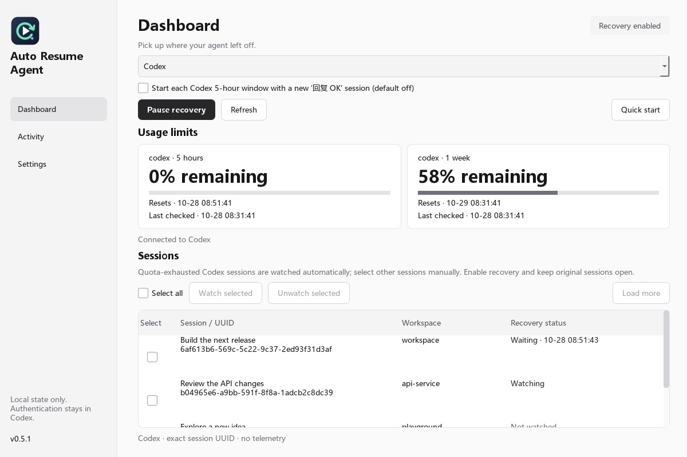
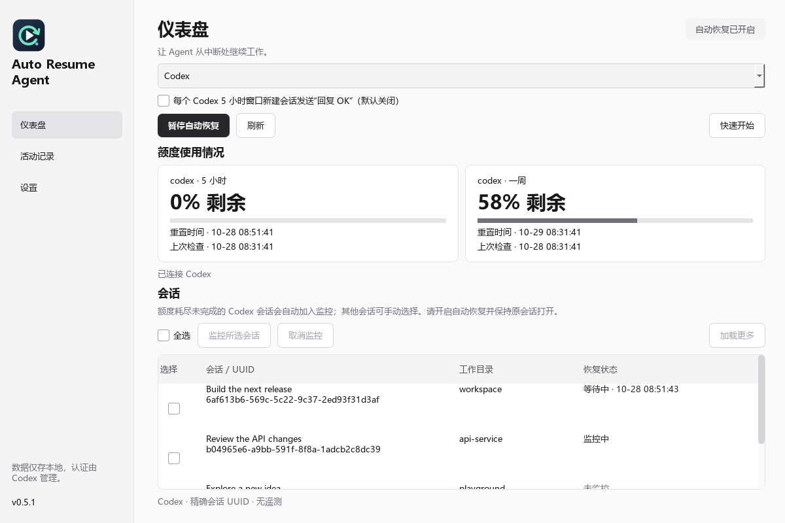
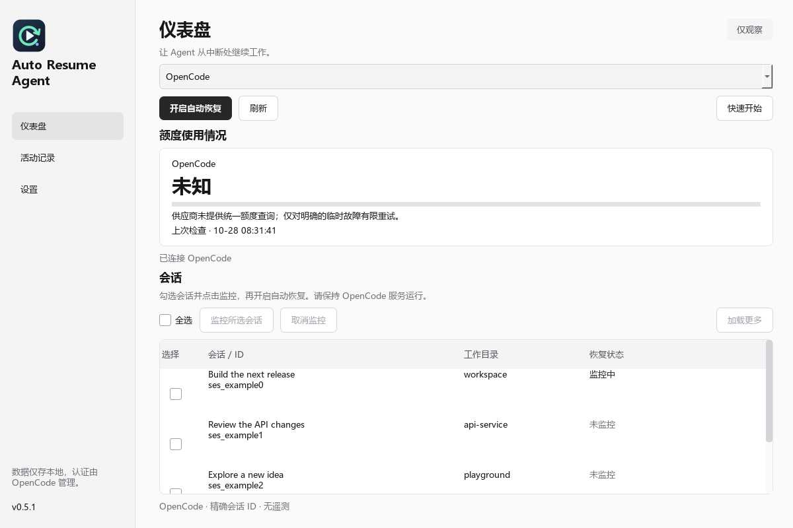

<div align="center">


# Auto Resume Agent

### Your agent hit the limit. Let it continue.

**A cross-platform desktop monitor that watches Codex and OpenCode usage and continues the exact interrupted session when capacity returns.**

[](https://github.com/yuan-xin-9997/auto-resume-agent/releases/latest)
[](#download--installation)
[](#languages)
[](https://autoresume.yuan-xin.top/)

English | [简体中文](README.zh-CN.md) | [Changelog](CHANGELOG.md)

**[Download](#download--installation) · [Features](#features) · [Pricing](#pricing-and-license) · [Activation](#activation) · [FAQ](#faq)**

</div>

> **About this repository**
>
> This is the official download and documentation repository for Auto Resume Agent. The source code is maintained in a private repository. Download the latest archive from [Releases](https://github.com/yuan-xin-9997/auto-resume-agent/releases/latest) or buy a license from the [store](https://autoresume.yuan-xin.top/).

## Overview

When a long agent task hits a usage limit, the turn fails halfway and the work stops. Auto Resume Agent watches the failed turn, reads the usage windows reported by the agent, and submits a continuation to that **exact session** when quota becomes available.

It never uses `--last`, never types into an agent window, and never starts an unrestricted replacement agent in the background.

Supported integrations:

- **Codex CLI / Codex Desktop** — tested with Codex CLI `0.163.0` (experimental app-server interface).
- **OpenCode 1.19.x** — HTTP session API.
- **OpenCode 2.x desktop** — experimental `/api` surface, including OpenCode Go / Go Plus quota windows.

Claude Code, Gemini CLI and cloud-only Codex sessions are not implemented.

## Screenshots

<div align="center">

</div>

<details>
<summary>Other interface languages</summary>

| 简体中文 | OpenCode |
| :---: | :---: |
|  |  |

</details>

## Features

| Feature | What you get |
| --- | --- |
| Usage monitoring | Live 5-hour, weekly and monthly windows, remaining percentage, reset times and last check. |
| Exact-session recovery | Continuation is sent to the stored session UUID / `ses_...` ID, never to “the latest session”. |
| Known failures only | Structured quota limits, rate limits and transient connection/server failures. User cancellations and unknown errors are excluded. |
| Honest delivery states | `Queued`, `Accepted`, `Delivery uncertain` and `Session progressed` are reported separately. Accepted does not prove execution. |
| Sleep/wake | Deadlines are re-evaluated on the next check after wake; missed windows do not cause a burst. |
| Durable claims | Submission intent is stored before the process boundary, so a crash or timeout never triggers blind resending. |
| Automatic adoption | Running and quota-interrupted sessions are watched automatically; completed sessions are unwatched after a grace period. |
| Codex window keeper | Optional first request at the next five-hour window when no recovery is pending. Off by default. |
| Five languages | English · 简体中文 · 繁體中文 · 日本語 · 한국어. |
| Signed updates | Daily signed-manifest check, SHA-256 archive verification, in-place update with rollback, and Stable / Beta channels. |
| Local and private | State stays in a local SQLite database. No telemetry. The app checks a signed update manifest at most once a day; disable it in Settings. |
| CLI | JSON output and exit codes for `usage`, `sessions`, `status`, `doctor`, `watch`, `check`, `add`, `enable` and licensing. |

## Download & installation

Download the archive matching your OS and processor from [Releases](https://github.com/yuan-xin-9997/auto-resume-agent/releases/latest). Python is bundled; **the agent you use must be installed separately and logged in**.

| Platform | Archive | Install |
| --- | --- | --- |
| Windows 10 1809+ / 11, x64 | [`AutoResumeAgent-windows-x64.zip`](https://github.com/yuan-xin-9997/auto-resume-agent/releases/latest/download/AutoResumeAgent-windows-x64.zip) | Extract the whole archive, run `Install.cmd`, then use the Desktop / Start Menu shortcut. |
| Ubuntu 24.04 / 26.04, x64 | [`AutoResumeAgent-linux-x64.tar.gz`](https://github.com/yuan-xin-9997/auto-resume-agent/releases/latest/download/AutoResumeAgent-linux-x64.tar.gz) | Extract, run `sh install.sh`, launch from Applications. |
| macOS 27, Apple Silicon | [`AutoResumeAgent-macos-arm64.tar.gz`](https://github.com/yuan-xin-9997/auto-resume-agent/releases/latest/download/AutoResumeAgent-macos-arm64.tar.gz) | Extract, run `sh install.sh`, open `~/Applications/AutoResumeAgent.app`. |
| macOS 27, Intel | [`AutoResumeAgent-macos-x64.tar.gz`](https://github.com/yuan-xin-9997/auto-resume-agent/releases/latest/download/AutoResumeAgent-macos-x64.tar.gz) | Same procedure, Intel build. |

Checksums: [`SHA256SUMS.txt`](https://github.com/yuan-xin-9997/auto-resume-agent/releases/latest/download/SHA256SUMS.txt).

The bundles are unsigned and not notarized. Use your OS's normal approval flow if it asks. The macOS CLI is installed in `~/.local/bin`; add it to `PATH` if necessary.

Verify the archive before extracting:

```powershell
Get-FileHash .\AutoResumeAgent-v1.1.1-windows-x64.zip -Algorithm SHA256
```

```sh
sha256sum AutoResumeAgent-v1.1.1-linux-x64.tar.gz
shasum -a 256 AutoResumeAgent-v1.1.1-macos-arm64.tar.gz
```

The adjacent `.sha256` file contains the expected value. See the [compatibility matrix](docs/COMPATIBILITY.md) for tested versions and evidence levels.

## Pricing and license

| | Free | Pro license |
| --- | --- | --- |
| Usage and session monitoring | ✓ | ✓ |
| Activity history and `doctor` | ✓ | ✓ |
| Automatic recovery | 14-day trial | ✓ |
| Codex window keeper | 14-day trial | ✓ |
| Queued-task retry | 14-day trial | ✓ |
| Offline activation | — | ✓ |
| Updates | — | 1 year |
| Computers per license | — | 2 |
| Support | Community | Priority email |

**$9.99 USD one-time.** No subscription. After the 14-day trial, monitoring remains free; automatic recovery is locked until a license is activated.

A license is bound to a machine code and verified offline with a public key embedded in the app. No account, online activation or telemetry is required.

**[Buy a license](https://autoresume.yuan-xin.top/)**

## Activation

1. Open Auto Resume Agent.
2. Go to **Settings → License**.
3. Copy the machine code shown there (for example `ABCD-EFGH-IJKL-MNOP`).
4. After purchase, paste the machine code into the confirmation page or the secure claim link and receive an `ARA-...` activation code.
5. Paste the activation code back into **Settings → License** and click **Activate**.

CLI:

```sh
auto-resume-agent license
auto-resume-agent activate "ARA-..."
auto-resume-agent deactivate
```

The activation code is verified locally. You only need the network to receive the code. An issued offline code cannot be revoked remotely; refunds and revocations only block future claims and reissues.

## FAQ

**Which agents are supported?**
Codex CLI / Codex Desktop (tested with `0.163.0`) and OpenCode 1.19.x / 2.x. Claude Code, Gemini CLI and cloud-only Codex sessions are not implemented.

**What does “Queued” mean?**
The Codex CLI accepted the continuation. It does not prove the original conversation resumed. Keep the original session open. A queued recovery that is not consumed within 10 minutes becomes **Needs attention**; you can retry it from the app after a confirmation prompt.

**Does the app send my conversations anywhere?**
No. Session metadata is read locally. Claiming a license sends only the machine code (an 8-byte hash plus checksum) and order details to the store. The daily update check sends only the current version and platform, and can be disabled. The app sends no telemetry.

**Does activation need a network connection?**
No. The code is verified offline with a public key built into the app. The network is only needed to receive the code.

**Can I use one license on several computers?**
One order covers two computers by default. Claim a separate code for each machine code. A code cannot be moved to another computer; contact support if you replace a computer.

**What happens after the trial?**
Monitoring, usage cards, the session list, activity history and `doctor` remain available. Automatic recovery, window-keeper requests and queued retries require a license.

**Which payment methods are supported?**
Creem is the merchant of record and handles cards, local payment methods, taxes, invoices and refunds. Available methods depend on your country and are shown at checkout.

**What is the refund policy?**
Contact support within 14 days of purchase with your order number and a short description. See the [refund policy](https://autoresume.yuan-xin.top/refund).

**Are the binaries signed?**
The application bundles are unsigned and not notarized. Update manifests are separately signed with ECDSA P-256, and every archive is verified by SHA-256 before installation. The release page and checksums remain the integrity reference.

**How do updates work?**
Installed per-user copies check a signed manifest at most once a day. **Download & install** verifies the manifest signature and archive SHA-256, swaps the installation in place and keeps the previous version for rollback. Portable and source copies show a download link instead of modifying themselves. Choose **Stable** or **Beta**, or disable update checks, in **Settings → Updates**.

## Support

- Store and license: <https://autoresume.yuan-xin.top/>
- Email: <support@yuan-xin.top>
- Issues and feature requests: [GitHub Issues](https://github.com/yuan-xin-9997/auto-resume-agent/issues)

When reporting a problem, include the version, OS/architecture, agent and version, the command or screen, and the exact error. Do not attach private conversation content.

## License

Auto Resume Agent is proprietary software. See the [license terms](LICENSE). Bundled third-party components retain their own licenses; see [THIRD_PARTY_NOTICES.md](THIRD_PARTY_NOTICES.md).
