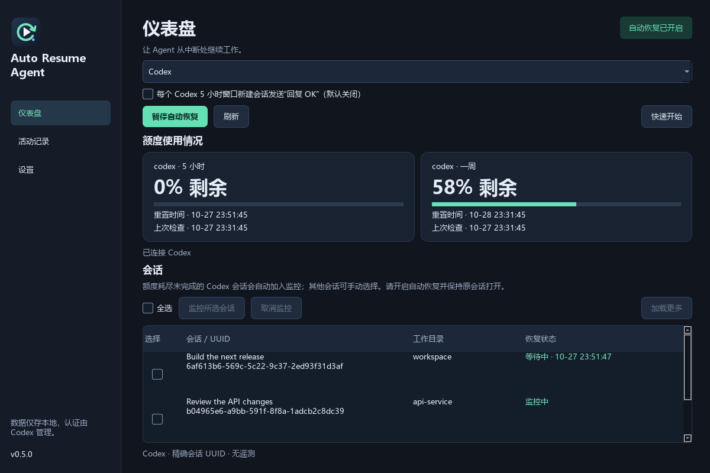
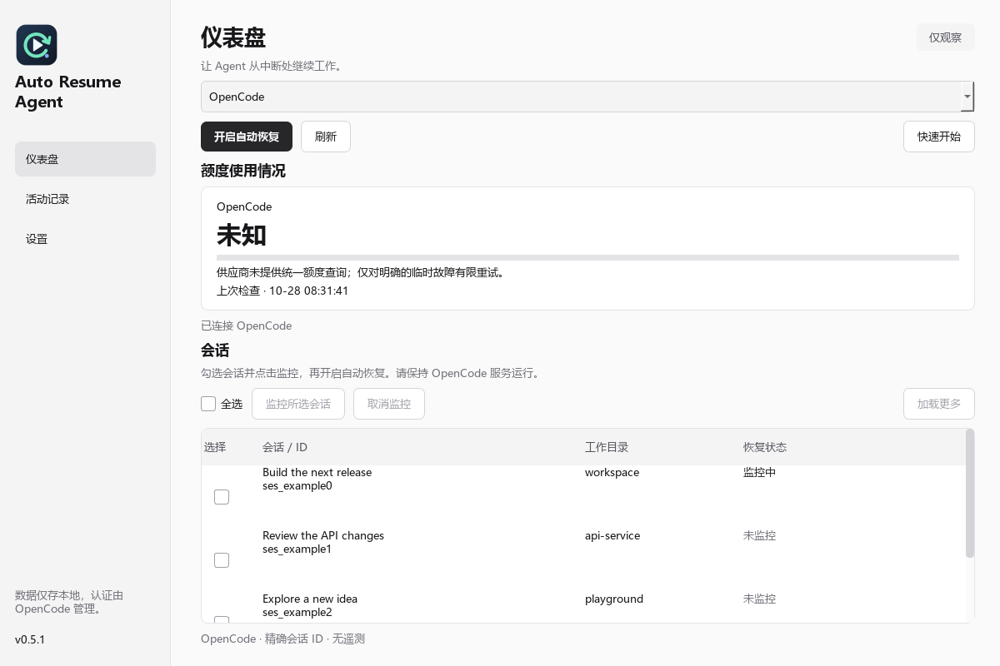
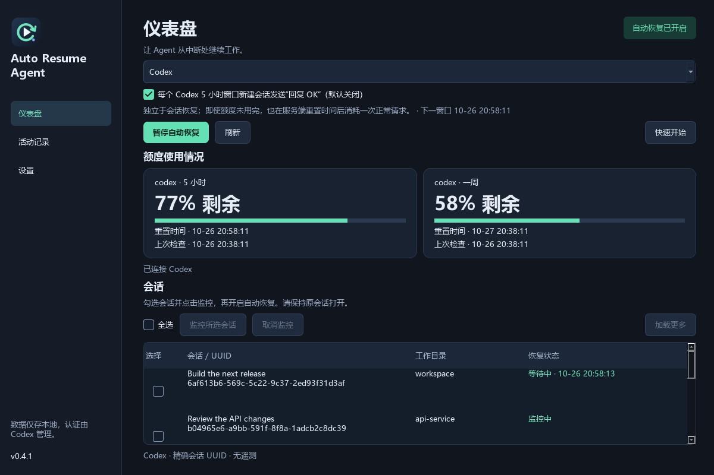

<p align="center"></p>

# Auto Resume Agent

跨平台 AI Agent 额度检测和原会话恢复工具。

[English](README.md) · [下载 Release](https://github.com/yuan-xin-9997/auto-resume-agent/releases) · [测试与兼容性](docs/TESTING.md)

**Windows、Ubuntu、macOS · 原生 GUI 和 CLI · 五种界面语言 · 本地存储 · 无遥测**

Agent 任务中途额度耗尽后，本软件检测失败轮次，查询 Codex 返回的额度窗口，在额度可用后向**同一会话 UUID**提交继续指令。不使用 `--last`，不模拟键盘向窗口输入。

现已支持 **Codex CLI、本地 Codex 桌面会话和 OpenCode HTTP 服务会话**。在仪表盘切换 Agent，或通过 CLI 的 `--agent opencode` 选择。Claude Code、Gemini CLI 和纯云端 Codex 会话尚未适配。



*示例会话和额度，不包含个人对话数据。*

| 功能 | 行为 |
| --- | --- |
| 额度检测 | 主、副额度窗口，剩余百分比，本地重置时间及检查时间 |
| 自动恢复 | 明确的额度、限流、连接、流中断和临时服务端错误 |
| 调度 | 通常每 5 秒检查会话，每 30 秒及恢复截止时间重新查询额度 |
| 休眠唤醒 | 下一次调度时重新计算真实时间，不因休眠继续等待旧倒计时 |
| 防重复 | 发送前保存领取状态，崩溃或超时后不盲目重发 |
| 多语言 | 英语、简体中文、繁体中文、日语、韩语，即时切换并保存 |

**重要限制：**“已排队”只表示 Codex CLI 接受了继续消息，不能证明任务已经执行。请保持原会话在 Codex 中打开；未加载的会话可能一直排队，打开后才能继续。“会话已继续”只证明出现了新轮次，不证明是本软件触发。本软件不会在后台另开不受限制的替代 Agent。

## 安装

从 [Releases](https://github.com/yuan-xin-9997/auto-resume-agent/releases) 下载对应系统和处理器的压缩包。原生包自带 Python，但仍需**单独安装并登录你使用的 Agent（Codex 或 OpenCode 服务）**。OpenCode 实测版本为 **1.19.3**。实际测试的 Codex CLI 版本为 **0.163.0**；其他版本请先运行 `doctor`，旧版本可能不支持相关实验接口。

| 系统 | 包名 | 启动方式 |
| --- | --- | --- |
| Windows 10 1809+ / 11 x64 | `*-windows-x64.zip` | 完整解压，运行 `Install.cmd`，之后使用桌面／开始菜单快捷方式 |
| Ubuntu 24.04 / 26.04 x64 | `*-linux-x64.tar.gz` | 解压，运行 `sh install.sh`，从应用菜单打开 |
| macOS 27 Apple Silicon | `*-macos-arm64.tar.gz` | 解压，运行 `sh install.sh`，打开 `~/Applications/AutoResumeAgent.app` |
| macOS 27 Intel | `*-macos-x64.tar.gz` | 同上，选择 Intel 包 |

以上是目标平台；请以[实际测试矩阵](docs/TESTING.md)为准。程序未进行商业代码签名和苹果公证，系统可能要求按正常流程批准打开。安装脚本不会修改系统安全设置。Mac CLI 放在 `~/.local/bin`，必要时将该目录加入 PATH。

使用压缩包旁的 `.sha256` 文件校验下载：Windows 用 `Get-FileHash 文件名 -Algorithm SHA256`，Ubuntu 用 `sha256sum 文件名`，Mac 用 `shasum -a 256 文件名`。

Windows 固定安装到 `%LOCALAPPDATA%/Programs/AutoResumeAgent`。每次下载新版后运行 `Install.cmd`，即可更新程序与快捷方式；设置和监控会话仍保存在 `%LOCALAPPDATA%/AutoResumeAgent`。也可使用 `Launch.cmd` 便携运行。

勾选会话复选框或使用“全选”，然后点击“监控所选会话”或“取消监控”；单独勾选不会改变监控状态。刷新时保留勾选。额度窗口以“5 小时”“一周”显示，支持五种界面语言。

[本机更新流程](docs/LOCAL_UPDATES.md)

若专用会话提示响应流断开，请在设置中填写 **Codex HTTP(S) 代理**（带端口，不含凭据），或使用 `--codex-proxy http://127.0.0.1:7890`。请填写自己的代理地址；程序不会假定端口。留空继承进程环境。此设置只传给 Codex 子进程，也包括独立的窗口启动客户端。

配置保存在本地 SQLite，关闭或重启程序后会恢复。语言、功能开关和监控选择即时保存；代理、可执行文件和 OpenCode 连接信息需点击“保存设置”。保存连接设置会暂停恢复，重新开启后该开关状态也会保留。

### 默认监控额度耗尽会话

Codex 会话的**最新轮次明确因额度耗尽而失败**时，默认自动加入监控，无需手动勾选。GUI 后台和 CLI 的 `watch`／`check` 都支持分页发现与分批检查，优先发现最近变动的会话。恢复仍遵守原有开启／暂停开关和额度检查。已完成、用户主动中断、归档、子 Agent 和五小时窗口专用会话不自动加入。

点击“取消监控”会保存排除记录，不会在下一次扫描时自动加回来；手动点击“监控所选会话”可解除排除。升级时保留旧版已取消且未监控会话的排除意图。在设置中可关闭“自动监控因额度耗尽未完成的 Codex 会话”，也可运行 `auto-resume-agent auto-watch off`；支持 `on`、`status`。关闭自动发现不会移除已有监控。OpenCode 没有相同的结构化 Codex 额度错误，仍需手动选择。

### 从源码运行

需要 Python 3.11 或更新版本：

```sh
python -m venv .venv
# 按当前 Shell 的方式激活 .venv
python -m pip install '.[gui]'
auto-resume-agent gui
```

无桌面服务器可用 `python -m pip install .`，只安装 CLI，不需要 Qt。Ubuntu GUI 依赖：

```sh
sudo apt-get install libegl1 libgl1 libxkbcommon0 libxcb-cursor0 libxcb-icccm4 libxcb-keysyms1 libxcb-shape0 libxcb-xinerama0
```

## 使用 OpenCode



*示例会话，不含个人数据。*

OpenCode 有官方 HTTP 会话接口，但**没有统一的供应商剩余额度查询 API**。界面明确显示“未知”，不会猜测剩余百分比。仅对明确可重试的 API 故障恢复，遵守 `Retry-After` 秒数或 HTTP 日期；无该头时采用有上限的退避，每个会话每小时最多提交五次。这是重试策略，不代表已确认额度可用。

```sh
opencode serve --hostname 127.0.0.1 --port 4096
# 需要处理权限或提问时，可连接终端：
opencode attach http://127.0.0.1:4096
```

也可使用已运行 TUI 的服务端口。在设置中填写服务地址和**服务端的绝对工作目录**，在仪表盘选择 **OpenCode**，监控 `ses_...` 会话并开启恢复。切换 Agent 或保存连接设置会暂停恢复，核对后再开启。一个 GUI 监控当前所选 Agent，可使用独立 CLI 进程分别监控两者，状态隔离。

```sh
auto-resume-agent --agent opencode --opencode-url http://127.0.0.1:4096 --opencode-directory /absolute/project doctor
auto-resume-agent --agent opencode sessions
auto-resume-agent --agent opencode usage
auto-resume-agent --agent opencode add ses_EXACT_SESSION_ID
auto-resume-agent --agent opencode enable
auto-resume-agent --agent opencode watch
auto-resume-agent --agent opencode pause
```

地址和目录会保存。CLI 不指定 `--agent opencode` 时仍默认 Codex。Basic 认证通过与服务端一致的 `OPENCODE_SERVER_PASSWORD` 和可选 `OPENCODE_SERVER_USERNAME` 环境变量提供，密码不写入数据库或 URL。HTTP 仅限本机回环地址，远程服务需 HTTPS，也可使用 SSH 隧道。请求不跟随重定向、不使用系统 HTTP 代理。

仅恢复 `isRetryable: true` 的 `APIError`：HTTP 429、408/425、5xx，或无状态码的连接错误。已知结构化账单／余额拒绝、认证失败、用户取消和未知错误不会自动恢复。运行中、自身重试中、等待权限或回答、子会话、已归档会话及存在回退操作时均不会插入消息。继续时保留原供应商、模型、Agent、variant 及原消息的工具限制、system 和格式设置，不会自动批准权限。

通过 `POST /session/{id}/prompt_async` 投递到精确会话。“已接受”仅表示 HTTP 接收确认，不证明已执行；新消息只证明会话进展，不证明是谁触发。模糊结果不会自动重发。只要服务仍在运行，TUI 关闭后也可继续；权限和提问仍须人工处理。

每组服务地址与目录在 `opencode/` 下有独立状态，原 Codex 状态保留。请固定使用同一地址和目录，避免其他恢复工具同时管理相同会话；地址别名或独立状态目录无法协调发送。

适配器在内存中读取会话状态和消息，以分类故障、保留继续设置，不持久化对话、原始错误或供应商凭据。供应商认证及模型请求由 OpenCode 处理，本适配器仅通过环境变量使用服务 Basic 认证。

接口依据：[OpenCode 官方服务文档](https://docs.opencode.ai/docs/server/)。

## Codex 5 小时窗口启动（默认关闭）

勾选仪表盘按钮上方的开关后，每次 Codex 主额度的 **300 分钟窗口截止**，会新建一个专用会话，发送准确文本 **回复 OK**；不要求旧窗口额度已经用完。此开关独立于“开启／暂停自动恢复”，也不要求存在监控会话。需要持续运行 Codex 监控且电脑保持唤醒；睡眠或关机期间无法在边界发送请求。GUI 切换到 OpenCode 后不运行 Codex 监控。



```sh
auto-resume-agent window-keeper status  # 只读查看，新安装默认关闭
auto-resume-agent window-keeper on     # 为当前 CODEX_HOME 保存开启设置
auto-resume-agent watch                # 运行监控，会话恢复可继续处于暂停状态
auto-resume-agent window-keeper off    # 停止后续窗口启动请求
```

按**服务端返回的重置时间**调度，不是从打开软件算五小时。开启时若返回的时间已过，首次符合条件的检查可立即发送。发送前会重新读取额度；可用性未知、周额度或其他可见窗口耗尽、账户消费限制都会等待。只有明确的 Codex 主窗口且时长为 300 分钟时才工作，包含两秒边界宽限以及正常轮询／网络延迟。

每个窗口在建会话前先持久化领取，重启、超时、关闭再开启或投递不确定都不会盲目重发。同一窗口最多尝试一次，两次尝试至少间隔五小时；休眠错过多个窗口，唤醒后只尝试一次，不补发一串请求。下一轮需等待服务端返回新的未来重置时间。关闭开关立即保存，并在建会话及发送消息前复查；已经提交的请求无法由开关撤回。

专用会话名称为 `Auto Resume Agent · 5h window`，使用空的临时工作目录和只读沙箱，明确要求只回复 OK、不调用工具。独立的 app-server 客户端仅能创建自己的一个新会话、命名并发送这一条固定消息，不能向用户已有会话启动轮次，不会批准客户端权限请求。原有会话恢复机制保持不变。

这会使用当前配置模型，**消耗一次正常 Codex 请求**，目的是尽早发出下一用量周期的首个请求；它**不能强制刷新额度、修改服务端规则、购买／兑换重置次数，也不能保证重置时间一定提前**。界面会区分“已回复 OK”和已接受、失败、投递不确定；服务或响应流异常可能导致无法得到 OK，但不会为同一窗口再发一遍。设置按 CODEX_HOME 隔离，安装及升级未主动开启时均为关闭。OpenCode 不支持此功能。

## 使用 Codex


1. 安装 [Codex CLI](https://github.com/openai/codex)，运行 `codex login`。
2. 打开本软件，在设置中选择语言；自动检测失败时填写 Codex 可执行文件路径。
3. 额度耗尽未完成的 Codex 会话默认自动加入监控；其他会话可勾选后点击“监控所选会话”，旧会话可通过“加载更多”查找。
4. 点击“开启自动恢复”，保持本软件和原 Codex 会话打开。
5. 在仪表盘和活动记录中查看等待、排队、投递不确定及新轮次状态。

新安装默认为“仅观察”。添加监控后，检测该会话最新的可重试失败及未来失败，即使最新失败发生在添加监控前一分钟以外。只检查监控会话的最新轮次，不恢复全部历史轮次，也不重新投递已取消或已领取的恢复记录。关闭 GUI 会停止该窗口的监控，不会偷偷安装开机服务。开启/暂停设置会保留到下次启动。

### 命令行

Windows 解压包把命令替换为 `cli\auto-resume-agent.exe`，Linux 安装前使用 `./cli/auto-resume-agent`。

```sh
auto-resume-agent doctor              # 只读检查连接、额度及会话接口
auto-resume-agent usage               # JSON 额度
auto-resume-agent sessions            # 分页列出本地会话，JSON Lines
auto-resume-agent add SESSION_UUID    # 监控指定 UUID
auto-resume-agent enable              # 允许自动恢复
auto-resume-agent watch               # 前台监控，Ctrl+C 退出
auto-resume-agent status              # 已保存额度、会话及恢复记录
auto-resume-agent pause               # 暂停自动发送
auto-resume-agent remove SESSION_UUID # 取消监控及等待中的恢复
auto-resume-agent cancel RECOVERY_ID  # 取消某条等待中的恢复记录
auto-resume-agent check               # 检查一轮；已开启恢复时可能发送
```

全局选项放在子命令前，如 `auto-resume-agent --codex /path/to/codex --home /path/to/state doctor`。`--codex` 会保存；`--home` 或环境变量 `ARA_HOME` 指定本软件数据目录。启动前设置 `CODEX_HOME` 可选择 Codex 配置，监控 UUID 绑定该目录。支持原生二进制和标准 npm 启动器，后者还需 Node.js；不执行任意 Shell 包装脚本。

Linux/Mac 可通过自己的服务管理器运行 `watch`。不要让另一款自动恢复工具同时管理相同会话：本软件只对共用同一状态目录的实例加锁，无法协调其他产品或独立状态目录。

## Codex 恢复规则与边界

- 仅处理明确选中的本地、未归档、支持来源的会话；不恢复子 Agent。
- 需要明确的结构化错误，以及新鲜的、确认可用的额度快照。未知额度继续等待。
- 同时考虑主、副额度窗口；时间戳已过但仍报告耗尽的快照不能授权发送。
- 临时故障采用有上限的退避，每个会话每小时最多提交五次，各错误类型共享上限。
- 有更新轮次时取消旧等待；不自动恢复权限、认证、策略、上下文超长、无效请求和用户取消。
- `codex queue` 前先持久化发送意图；超时、崩溃或模糊结果转为“投递不确定”，须检查原会话，不自动重发。
- 最新轮次读取与排队命令之间仍有很小的竞争窗口，Codex CLI 没有“仅当轮次未变才排队”的原子接口；其他客户端可能在此期间操作。因此不能承诺跨两个程序严格恰好执行一次。

检查间隔是调度目标，不是实时保证。休眠、网络、Codex 响应速度和监控会话数量会增加延迟。本软件不会唤醒休眠的电脑，需要在会话所在主机运行。

## 隐私和数据

无遥测、分析和自动更新网络客户端，认证和 OpenAI 请求由你安装的 Codex 处理。本软件 app-server 客户端只调用初始化、额度和会话元数据接口，不能批准工具或启动轮次；恢复通过独立的官方 `codex queue` 命令。

本地 SQLite 保存设置、监控 UUID、数值额度快照、分类恢复记录、可选窗口启动记录／专用会话 UUID 和有数量上限的事件代码，不保存提示词、对话全文、原始错误、Token 或 API Key。会话名称和工作目录只在 GUI 内存中展示，也会由 `sessions` 命令打印；重定向命令输出时请自行管理这些数据。

仅在本地排障时，可设置 `ARA_DEBUG_LOG` 为文件路径，主动保存 Codex app-server 的 stderr。该可选原始诊断文件可能包含私人路径和错误详情，分享前应检查；默认关闭，与正常状态数据库分开。

| 系统 | 默认状态目录 |
| --- | --- |
| Windows | `%LOCALAPPDATA%\AutoResumeAgent` |
| Linux | `${XDG_STATE_HOME:-~/.local/state}/auto-resume-agent` |
| macOS | `~/Library/Application Support/AutoResumeAgent` |

卸载时删除安装文件和启动入口。仅在确需丢弃设置及恢复历史时额外删除状态目录；升级时保留，避免已领取的中断被再次提交。

## 开发与发布

```sh
python -m pip install -e '.[gui,build,test]'
python -m pytest -q
python scripts/make_icons.py
python scripts/build.py
```

在目标系统及架构原生构建。GitHub Actions 测试并构建 Windows x64、Linux x64、Mac arm64 和 x64。所有构建通过后，版本标签自动发布包含校验和的 **prerelease**。详见[发布说明](docs/RELEASE_NOTES.md)与[测试证据](docs/TESTING.md)。

## 致谢与许可证

参考 [songyb111-gachon/codex-auto-resume-windows](https://github.com/songyb111-gachon/codex-auto-resume-windows) 的精确会话识别、谨慎投递和安装优先的文档组织方式。本项目是独立跨平台实现，不隶属于 OpenAI 或参考项目。

接口依据：[官方 Codex app-server 文档](https://learn.chatgpt.com/docs/app-server)。项目代码采用 MIT 许可证，打包的第三方库保留各自许可证，见[第三方声明](THIRD_PARTY_NOTICES.md)。
