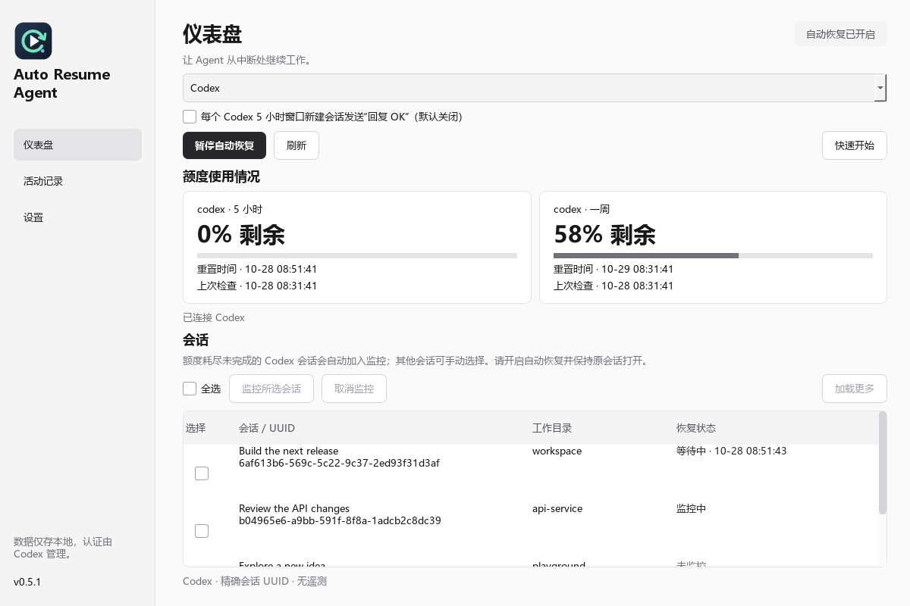
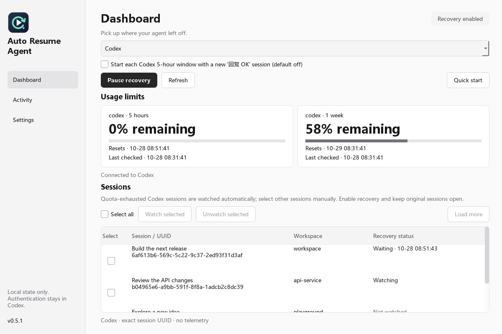
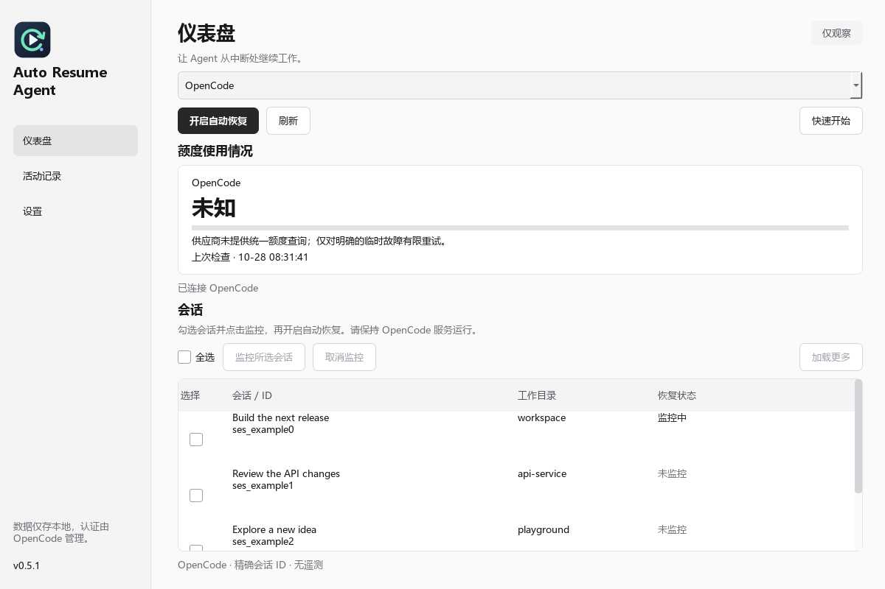

<div align="center">


# Auto Resume Agent

### Agent 撞到额度上限，让它自己继续。

**跨平台桌面监控工具：观察 Codex 与 OpenCode 的额度，额度恢复后继续被中断的同一个会话。**

[](https://github.com/yuan-xin-9997/auto-resume-agent/releases/latest)
[](#下载安装)
[](#界面语言)
[](https://autoresume.yuan-xin.top/)

[English](README.md) | 简体中文 | [更新日志](CHANGELOG.md)

**[下载](#下载安装) · [功能特性](#功能特性) · [价格与授权](#价格与授权) · [激活](#激活) · [常见问题](#常见问题)**

</div>

> **关于本仓库**
>
> 本仓库用于发布 Auto Resume Agent 官方安装包和用户文档；源代码维护在私有仓库中。请从 [Releases](https://github.com/yuan-xin-9997/auto-resume-agent/releases/latest) 下载安装包，或在 [销售网站](https://autoresume.yuan-xin.top/) 购买授权。

## 项目介绍

长时间运行的 Agent 任务撞到额度上限时，当前轮次会中断，工作停在那里。Auto Resume Agent 会观察失败的轮次，读取 Agent 报告的额度窗口，并在额度恢复后向**同一个会话**提交继续指令。

它从不使用 `--last`，不会向 Agent 窗口模拟键盘输入，也不会在后台另开一个不受限制的替代 Agent。

已支持的集成：

- **Codex CLI / Codex Desktop**：实测 Codex CLI `0.163.0`（实验性 app-server 接口）。
- **OpenCode 1.19.x**：HTTP 会话 API。
- **OpenCode 2.x 桌面版**：实验性 `/api`，包含 OpenCode Go / Go Plus 额度窗口。

Claude Code、Gemini CLI 和仅云端的 Codex 会话暂未实现。

## 界面预览

<div align="center">

</div>

<details>
<summary>其他界面</summary>

| English | OpenCode |
| :---: | :---: |
|  |  |

</details>

## 功能特性

| 功能 | 说明 |
| --- | --- |
| 额度监控 | 5 小时、每周、每月窗口，剩余百分比、重置时间和上次检查时间。 |
| 精确会话恢复 | 继续指令发往保存的会话 UUID / `ses_...` ID，不会发给“最新会话”。 |
| 只恢复明确故障 | 结构化额度上限、限流和临时连接/服务故障；用户取消和未知错误不会触发。 |
| 诚实的状态 | `已排队`、`已接受`、`投递不确定`、`会话已继续` 分开报告；接受不等于执行。 |
| 睡眠唤醒 | 唤醒后重新计算截止时间；错过多个窗口也只尝试一次。 |
| 持久化声明 | 提交前先落库，崩溃或超时不会盲目重发。 |
| 自动纳管 | 运行中和因额度中断的会话自动加入监控；完成的会话在宽限期后自动移出。 |
| Codex 窗口启动 | 可选：没有待恢复任务时，在下一个五小时窗口发送一次正常请求。默认关闭。 |
| 五种语言 | English · 简体中文 · 繁體中文 · 日本語 · 한국어。 |
| 签名更新 | 每日检查签名清单，校验 SHA-256 后原地更新并支持回滚；可选 Stable / Beta 通道。 |
| 本地隐私 | 状态保存在本地 SQLite，无遥测。应用每天最多检查一次签名更新清单，可在设置中关闭。 |
| CLI | `usage`、`sessions`、`status`、`doctor`、`watch`、`check`、`add`、`enable` 和授权命令，支持 JSON 和退出码。 |

## 下载安装

从 [Releases](https://github.com/yuan-xin-9997/auto-resume-agent/releases/latest) 下载对应系统和处理器的压缩包。原生包自带 Python；**你使用的 Agent 需要单独安装并登录**。

| 系统 | 包名 | 安装方式 |
| --- | --- | --- |
| Windows 10 1809+ / 11 x64 | [`AutoResumeAgent-windows-x64.zip`](https://github.com/yuan-xin-9997/auto-resume-agent/releases/latest/download/AutoResumeAgent-windows-x64.zip) | 完整解压，运行 `Install.cmd`，之后使用桌面／开始菜单快捷方式。 |
| Ubuntu 24.04 / 26.04 x64 | [`AutoResumeAgent-linux-x64.tar.gz`](https://github.com/yuan-xin-9997/auto-resume-agent/releases/latest/download/AutoResumeAgent-linux-x64.tar.gz) | 解压，运行 `sh install.sh`，从应用菜单打开。 |
| macOS 27 Apple Silicon | [`AutoResumeAgent-macos-arm64.tar.gz`](https://github.com/yuan-xin-9997/auto-resume-agent/releases/latest/download/AutoResumeAgent-macos-arm64.tar.gz) | 解压，运行 `sh install.sh`，打开 `~/Applications/AutoResumeAgent.app`。 |
| macOS 27 Intel | [`AutoResumeAgent-macos-x64.tar.gz`](https://github.com/yuan-xin-9997/auto-resume-agent/releases/latest/download/AutoResumeAgent-macos-x64.tar.gz) | 同上，Intel 版本。 |

校验值：[`SHA256SUMS.txt`](https://github.com/yuan-xin-9997/auto-resume-agent/releases/latest/download/SHA256SUMS.txt)。

安装包未签名、未公证。如系统提示，请按系统正常流程确认。macOS 命令行安装在 `~/.local/bin`，必要时加入 `PATH`。

解压前校验 SHA-256：

```powershell
Get-FileHash .\AutoResumeAgent-v1.1.1-windows-x64.zip -Algorithm SHA256
```

```sh
sha256sum AutoResumeAgent-v1.1.1-linux-x64.tar.gz
shasum -a 256 AutoResumeAgent-v1.1.1-macos-arm64.tar.gz
```

压缩包旁的 `.sha256` 文件包含期望值。实测版本和证据级别见[兼容性矩阵](docs/COMPATIBILITY.md)。

## 价格与授权

| | 免费 | Pro 授权 |
| --- | --- | --- |
| 额度与会话监控 | ✓ | ✓ |
| 活动记录和 `doctor` | ✓ | ✓ |
| 自动恢复 | 14 天试用 | ✓ |
| Codex 窗口启动 | 14 天试用 | ✓ |
| 排队任务重试 | 14 天试用 | ✓ |
| 离线激活 | — | ✓ |
| 更新 | — | 1 年 |
| 每份授权可绑定电脑 | — | 2 台 |
| 支持 | 社区 | 优先邮件 |

**$9.99 USD 一次买断**，不是订阅。14 天试用结束后，监控仍然免费；自动恢复需要激活授权。

授权绑定机器码，使用内置公钥离线验证，不需要账号、在线激活或遥测。

**[购买授权](https://autoresume.yuan-xin.top/)**

## 激活

1. 打开 Auto Resume Agent。
2. 进入 **设置 → 授权**。
3. 复制其中的机器码（例如 `ABCD-EFGH-IJKL-MNOP`）。
4. 购买后，把机器码粘贴到确认页或安全领取链接，获得 `ARA-...` 激活码。
5. 把激活码粘贴回 **设置 → 授权**，点击 **激活**。

命令行：

```sh
auto-resume-agent license
auto-resume-agent activate "ARA-..."
auto-resume-agent deactivate
```

激活码在本机离线验证，只有在领取激活码时才需要网络。已经签发的离线码无法远程失效；退款和吊销只会阻止后续领取和换机。

## 常见问题

**支持哪些 Agent？**
Codex CLI / Codex Desktop（实测 `0.163.0`）和 OpenCode 1.19.x / 2.x。Claude Code、Gemini CLI、仅云端 Codex 会话暂未实现。

**“已排队”是什么意思？**
表示 Codex CLI 已接受继续消息，但不能证明原会话已经执行。请保持原会话打开。排队超过 10 分钟会变成 **需要处理**，可以在应用中确认后重试。

**程序会把我的对话上传吗？**
不会。会话元数据在本机读取。领取授权时只把机器码（8 字节哈希 + 校验码）和订单信息发送到商店。每日更新检查只发送当前版本和平台，可在设置中关闭。软件没有遥测。

**激活需要联网吗？**
不需要。激活码由内置公钥离线验证；网络只用于领取激活码。

**一份授权可以用几台电脑？**
默认一个订单覆盖 2 台电脑。每台电脑用自己的机器码领取一个码。激活码不能转移到另一台电脑；更换电脑请联系支持。

**试用结束后还能用吗？**
额度卡片、会话列表、活动记录和 `doctor` 仍然可用；自动恢复、窗口启动和排队任务重试需要授权。

**支持哪些支付方式？**
Creem 作为 Merchant of Record 负责银行卡、本地支付、税费、发票和退款。具体方式取决于国家，在结账页显示。

**退款政策是什么？**
购买后 14 天内联系支持，附上订单号和问题描述。见[退款政策](https://autoresume.yuan-xin.top/refund)。

**安装包签名了吗？**
应用安装包未签名、未公证。更新清单使用独立的 ECDSA P-256 签名，安装前会校验压缩包的 SHA-256。完整性和来源仍以 Releases 页面和校验值为准。

**自动更新是如何工作的？**
已安装的用户级副本每天最多检查一次签名清单。点击**下载并安装**后会校验清单签名与压缩包 SHA-256，原地替换安装目录并保留上一版本用于回滚。便携版和源码运行不会修改自身，只显示下载链接。可在**设置 → 更新**中选择 **Stable** / **Beta** 或关闭检查。

## 支持

- 商店与授权：<https://autoresume.yuan-xin.top/>
- 邮箱：<support@yuan-xin.top>
- 问题和建议：[GitHub Issues](https://github.com/yuan-xin-9997/auto-resume-agent/issues)

报告问题时请提供版本、系统/架构、Agent 及版本、执行的命令或界面，以及完整错误。不要附带私人对话内容。

## 许可证

Auto Resume Agent 为专有商业软件，见[许可条款](LICENSE)。打包的第三方组件保留各自许可证，见[第三方声明](THIRD_PARTY_NOTICES.md)。
